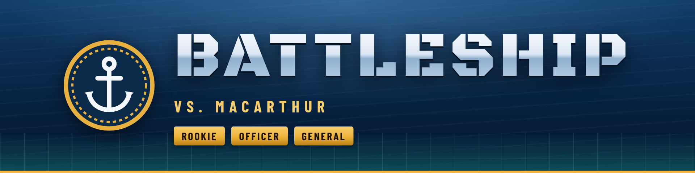
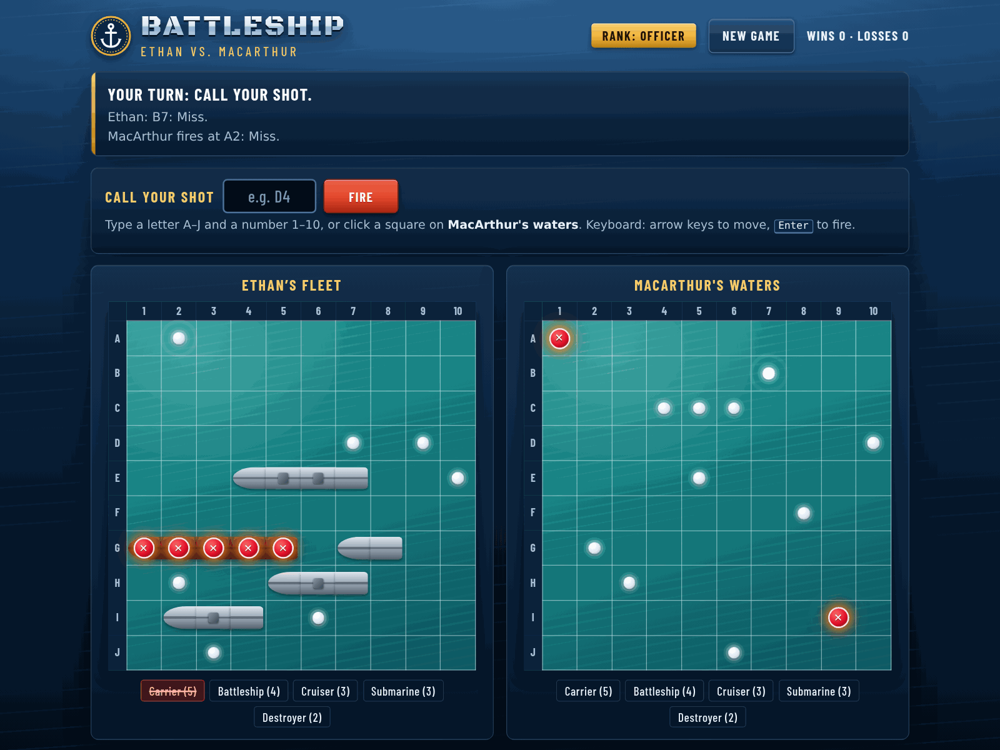
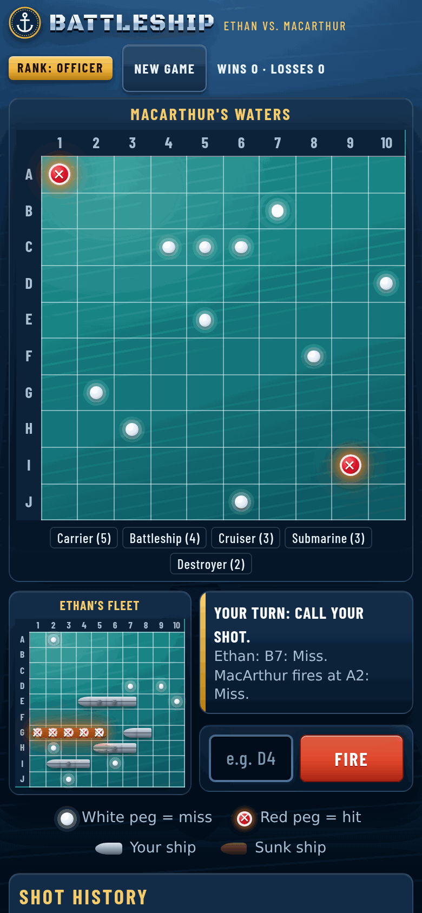

<p align="center">
  <a href="https://ethanswergold-sys.github.io/battleship-cog/"></a>
</p>

<p align="center"><b>Classic Battleship in your browser: you against MacArthur, a computer opponent with three ranks.</b></p>

<p align="center">
  <a href="https://ethanswergold-sys.github.io/battleship-cog/"></a><br>
  <sub>https://ethanswergold-sys.github.io/battleship-cog/ · phone, tablet or laptop · nothing to install</sub>
</p>

<p align="center">
  
  &nbsp;
  
</p>

## How to play

1. **Pick your opponent.** Type your name if you like, then choose MacArthur's rank: Rookie, Officer or General.
2. **Place your fleet.** Tap a square to place each of your 5 ships. Use Rotate (or Shift) to turn them, or press Randomize.
3. **Fire.** A coin flip decides who shoots first. Tap a square on MacArthur's waters, or type one like `D4`. One shot per turn.
4. **Read the pegs.** White peg = miss, red peg = hit. You're told when a ship sinks.
5. **Win.** Sink all 5 of MacArthur's ships before he sinks yours. Then Play again or Change rank.

Works with a mouse, a touchscreen or the keyboard alone (Tab, arrow keys and Enter), and screen readers
announce every shot. Your win/loss tally is kept until you close the window.

---

## For engineers

Plain HTML, CSS and JavaScript: no frameworks, no build step, no backend. It runs on GitHub Pages straight
from the repo root, or by double-clicking `index.html` (the scripts are classic `<script>` tags, not modules,
so browsers allow them from disk).

### How MacArthur plays

MacArthur never sees your ships. He only learns "miss", "hit" or "sunk" after each shot, like a human player.
Each rank is a separate file behind the same four functions (`placeShips`, `chooseShot`, `recordResult`,
`reset`), so the game doesn't care which rank it's talking to.

- **Rookie:** fires at a random square he hasn't tried yet and ignores his hits.
- **Officer:** hunts on a checkerboard pattern (every ship is at least 2 long, so it can't hide between the
  squares). After a hit he tries the neighbouring squares, follows the line once he finds a second hit, and
  keeps going until the ship sinks.
- **General:** before every shot he counts, for each untried square, how many ways each ship still afloat
  could lie across it without crossing a miss or a sunk ship, and fires at the most likely square (ties
  broken at random). Placements through unsunk hits count for much more, so he finishes off damaged ships.

All three place their own ships at random, and every rank is named MacArthur.

**Simulation results** (`node tests/simulate.js`): 1,000 games per rank against a randomly placed fleet.

| Rank | Average shots to win | Fewest | Most | Slowest shot choice |
|---|---|---|---|---|
| Rookie | 95.4 | 73 | 100 | 0.49 ms |
| Officer | 50.9 | 23 | 66 | 0.31 ms |
| General | 44.9 | 20 | 71 | 1.94 ms |

The automated tests also play 1,000 games per rank and fail if MacArthur ever repeats a square, fires off the
board or takes 100 ms or more to choose a shot.

### Project structure

| File | What it does |
|---|---|
| `index.html` | The page: both boards, controls and messages. |
| `BUGS.md` | Every bug and style fix made so far, with how it was found and fixed. |
| `docs/` | The banner, button and screenshots used in this README. Not used by the game. |
| `favicon.svg` | The little anchor picture that shows on the browser tab and in bookmarks. |
| `css/styles.css` | Look and layout for phones and laptops. |
| `fonts/` | The two lettering styles used on the page (the stencil title and the condensed labels), stored here so the game looks right even offline. Both are free to use under the licence files in the same folder. |
| `js/ui.js` | Draws the screen and handles clicks, taps and keys. Makes no rule decisions. |
| `js/main.js` | Starts the game and connects the rules and MacArthur to the screen. |
| `js/rules.js` | The game rules: placing ships, firing shots, hits, misses, sinking, turns, winning. No screen code. |
| `js/opponents.js` | The list of ranks MacArthur can play at, and the one place that creates "the current opponent" and starts each fresh battle. |
| `js/ranks/rookie.js` | Rookie rank: fires at random untried squares and ignores hits. No screen code. |
| `js/ranks/officer.js` | Officer rank: hunt-and-target strategy. No screen code. |
| `js/ranks/general.js` | General rank: probability map of where the remaining ships could be. No screen code. |
| `tests/rules.test.js` | Automated checks for the rules. |
| `tests/opponents.test.js` | Automated checks for the ranks, including thousands of simulated games. |
| `tests/simulate.js` | Plays 1,000 games per rank and prints a table of average, fewest and most shots: `node tests/simulate.js`. |
| `tests/run.html` | Open in any browser to run the automated checks. |
| `tests/harness.js` | The small test runner used by `tests/run.html`. |

### Running the tests

The automated tests check the game rules and MacArthur at every rank without opening the game. They cover:

- **Ship placement:** ships can't overlap or go off the board, and every square is checked for every ship in
  both directions, including the last row (J) and last column (10).
- **Firing:** hits, misses and sinks are reported correctly and pass the turn. A shot at a square that was
  already tried is rejected and doesn't use up the turn.
- **Winning:** the game ends exactly when the last ship square is hit, not one shot earlier.
- **MacArthur:** at every rank (Rookie, Officer, General), he never fires at the same square twice or off the
  board, across 1,000 simulated games per rank.
- **Play Again and Change rank:** both boards, both fleets and MacArthur's memory are fully reset.

There are three ways to run them:

1. **In a browser, no install needed:** double-click `tests/run.html`. Each check shows PASS or FAIL, and the
   total is at the top. It takes a few seconds.
2. **From a terminal:** install [Node.js](https://nodejs.org) 18 or newer, open a terminal in this folder and run:
   ```
   node --test tests/*.test.js
   ```
   The last lines show how many tests passed (`pass`) and failed (`fail`).
3. **On GitHub, automatically:** every pull request runs the tests (see `.github/workflows/test.yml`). The
   result appears as the **test** check near the bottom of the pull request: a green tick means everything
   passed.

To see how many shots each rank needs to win, run `node tests/simulate.js`.

### Hosting

GitHub Pages: Settings → Pages → deploy from the `main` branch, root folder. No build step.

---

## Bugs and fixes

Every bug and style fix so far, with how it was found, how to reproduce it and how it was fixed, is listed in
[BUGS.md](BUGS.md).

## How this was built

This game was built with [Devin](https://devin.ai), an AI software engineer, working from plain-English
requests by the project owner. Every change went through its own pull request with a plain-English
description. Each pull request was checked by the automated tests and an automated code reviewer, then
reviewed and approved by the owner before it was merged. Nothing was pushed straight to `main`.

See every change in the [closed pull requests list](https://github.com/ethanswergold-sys/battleship-cog/pulls?q=is%3Apr+is%3Aclosed).

### Version history

| Pull request | What it added |
|---|---|
| [#1](https://github.com/ethanswergold-sys/battleship-cog/pull/1) | Game rules and automated tests |
| [#2](https://github.com/ethanswergold-sys/battleship-cog/pull/2) | MacArthur, the computer opponent |
| [#3](https://github.com/ethanswergold-sys/battleship-cog/pull/3) | The playable game page |
| [#4](https://github.com/ethanswergold-sys/battleship-cog/pull/4) | Rookie and Officer ranks |
| [#5](https://github.com/ethanswergold-sys/battleship-cog/pull/5) | General rank |
| [#6](https://github.com/ethanswergold-sys/battleship-cog/pull/6) | Rank picker before each battle |
| [#7](https://github.com/ethanswergold-sys/battleship-cog/pull/7) | Player name on the start screen |
| [#8](https://github.com/ethanswergold-sys/battleship-cog/pull/8) | More automated rule tests |
| [#9](https://github.com/ethanswergold-sys/battleship-cog/pull/9) | Naval taglines for the ranks |
| [#10](https://github.com/ethanswergold-sys/battleship-cog/pull/10) | Naval look for the whole game |
| [#11](https://github.com/ethanswergold-sys/battleship-cog/pull/11) | Anchor tab icon |
| [#12](https://github.com/ethanswergold-sys/battleship-cog/pull/12) | Both boards fit on a phone screen |
| [#13](https://github.com/ethanswergold-sys/battleship-cog/pull/13) | This README, `BUGS.md` and the screenshots |

**Undoing a change:** open that pull request on GitHub and press **Revert**. GitHub opens a new pull request
that removes just that change; merge it and the live game updates within a few minutes. From a terminal,
`git revert -m 1 <merge commit>` does the same.
